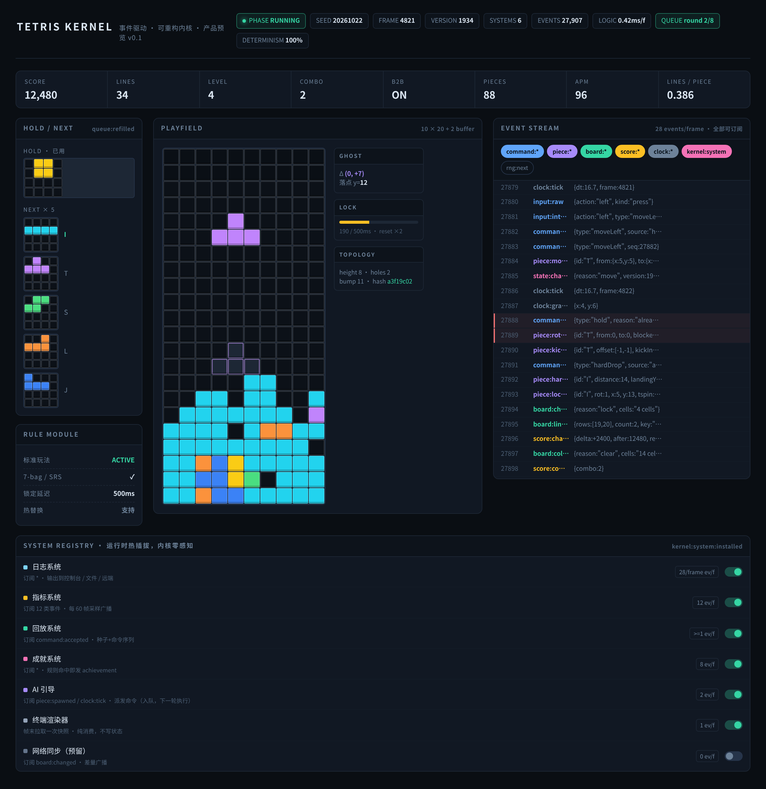
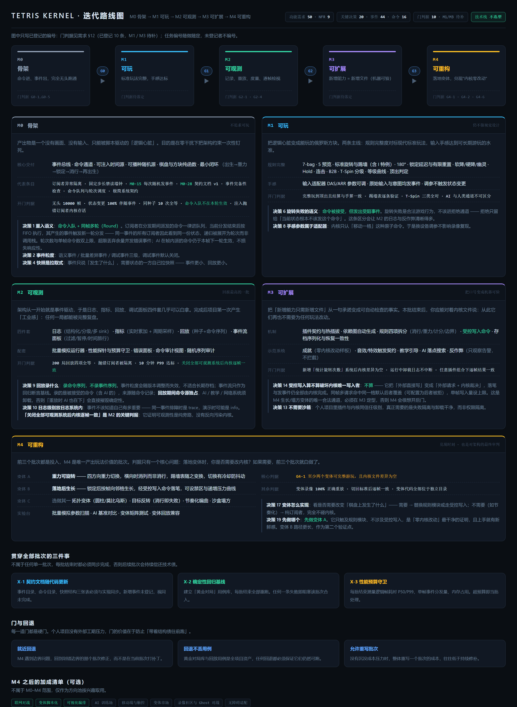

# 需求与边界 · Tetris Kernel

| 项目 | 内容 |
| --- | --- |
| 定位 | 一个以「事件流」为唯一信息载体的俄罗斯方块内核。目标不是"做一个俄罗斯方块"，而是做一个能让俄罗斯方块被反复重构的底座 |
| 技术栈 | **不做选型**。全部需求以「能力契约」描述，任何语言、渲染方式、运行平台均须可实现 |
| 规模 | 功能需求 50 条 · 非功能需求 9 条 · 关键决策 20 项（已誊入 ADR 的见 `决策记录.md` C 节映射表）· 事件 44 个 · 命令 16 个 |
| 本文件管什么 | **做什么 + 坚决不做什么**。需求变了才改这里，实现细节与理由不进本文件 |
| 配套 | `项目架构.md`（技术栈 / 目录 / 数据模型 / 模块边界 / 实现红线）· `决策记录.md`（为什么选 A 不选 B）· `../PROGRESS.md`（分批任务与当前进度） |

> **门判据编号**：本文件用到的门判据编号集中在 §12（`G2-1` / `G2-4` / `G4-1` / `G4-2` / `G4-6`）。M0 / M1 / M3 的编号尚未落地——**引用门判据只写已有的编号，不要凭编号推断内容**。

> **三张图的位置**：图 1（产品主界面）在本文件 §3；图 2（架构与扩展）在 `项目架构.md` §2；图 3（路线图）在本文件 §12。三者均为**直观示意**，其中的分数、帧号、事件计数等数值是示例值，**实现以本文件结论与 §8 契约为准**。图 1 与图 2 共用一份 HTML 源文件，图 3 单独一份，都在 `html源文件/` 下；改图改 HTML 再重新截图，不要手改 PNG。

---

## 1. 要解决的问题

常规俄罗斯方块的写法把规则、输入、渲染、计分耦合在一起。想加一个新机制（重力翻转、落地后生长、塌方物理），就得改动主循环和状态判断，牵一发动全身，且无法验证改动有没有破坏原有手感。

本项目的目标不是"做一个俄罗斯方块"，而是**做一个能让俄罗斯方块被反复重构的底座**。任何一次玩法创新，都应当只表现为"新增一个订阅者"，而不需要修改内核。

## 2. 成功标准

| # | 标准 | 判定依据 |
| --- | --- | --- |
| S-1 | 新增任意玩法机制，内核代码**零改动**即可生效 | AC-3、G4-1 |
| S-2 | 同一份「种子 + 输入序列」在任何环境下重放，结果**逐帧一致** | AC-1、NFR-1 |
| S-3 | 系统内发生的**每一件事**（含被拒绝的操作、每一次随机数）都可被订阅、记录、回放 | AC-2、NFR-7 |
| S-4 | 内核可脱离渲染与输入独立运行，用于测试、AI 训练与批量模拟 | AC-5 |

## 3. 最终形态

M2 完成之后系统达到完整形态。此时同时挂载六类订阅者，各自只消费事件、只派发命令，彼此不知道对方存在：

| 挂载模块 | 消费的事件 | 产出 |
| --- | --- | --- |
| 日志系统 | 全局（`*`） | 结构化日志条目 |
| 指标系统 | 12 类语义事件 | 周期采样的聚合指标 |
| 回放系统 | `command:accepted` | 种子 + 命令序列录像 |
| 成就系统 | 全局（`*`） | `achievement:unlocked` |
| AI 引导 | `piece:spawned`、`clock:tick` | 派发命令 |
| 渲染器 | `state:changed` + 快照 | 画面 |

由此产生四条结论：

1. **事件流是核心资产，不是调试附属品。** 命令的三段生命周期（received / accepted / rejected）、方块操作、棋盘消行、计分、成就、随机取值、插件安装全部在流中。**"命令被拒绝"与"每一次取随机数"也必须有事件**（N5）。完整清单见 §8.1。
2. **所有订阅者地位平等。** 日志、指标、回放、成就、AI、渲染器并列，各自可随时装载或卸载，内核不知道它们存在（FR-9.1、AC-8）。
3. **渲染器只是又一个订阅者。** 棋盘、幽灵落点、锁定进度、HOLD / NEXT 全部由 §8.3 的快照字段驱动；换成终端渲染或网络同步，内核无感（FR-8.1）。
4. **任何展示数据都来自事件聚合或快照**，渲染层不自行计算任何业务数值（FR-8.2）。

**图 1　最终形态的界面示意（M2 完成后，数值为示例值）**

## 4. 术语表

| 术语 | 定义 |
| --- | --- |
| 命令（Command） | 外部对内核表达的**意图**。可以被接受，也可以被拒绝。不直接改变状态 |
| 事件（Event） | 已经发生的**事实**。不可变、可广播、可持久化。是系统对外输出的唯一形式 |
| 内核（Core） | 唯一的状态所有者。只接受命令，只发出事件 |
| 总线（Bus） | 事件的传输与分发中枢，支持订阅、通配、中间件与历史回溯 |
| 系统（System） | 可插拔的功能模块，形如插件。只能订阅事件 + 派发命令，不得直接读写内核状态 |
| 适配器（Adapter） | 输入、渲染、存储、网络等与外界交互的部件，全部降格为系统的一种 |
| 帧（Frame） | 固定步长的逻辑时间单位。所有时间推进以帧为单位注入，不使用墙钟时间 |
| 快照（Snapshot） | 某一时刻内核完整状态的只读导出，用于渲染、存档、AI 与同步 |
| 命令队列（Command Queue） | 事件分发期间由订阅者派发的命令的暂存区；队列中的命令不在当前分发周期内执行 |
| 分发轮次（Round） | 一次事件分发及其所引发的命令执行构成的层级；命令递归被展开为同一帧内的多个轮次 |
| 规则模块（Rule Module） | 承载"判定结果是什么"的可替换单元（消行 / 重力 / 计分 / 边界） |
| 规则集（Rule Set） | 一组规则模块配置的完整组合，带唯一标识，用于区分标准玩法与变体 |
| 受控写入 | 外部系统请求变更棋盘时，必须经内核校验后落笔的机制 |
| 变体（Variant） | 基于同一内核、通过替换规则模块或新增订阅者产出的新玩法 |

## 5. 架构约束（硬性，不可协商）

以下七条是本项目存在的理由，任何实现方案都必须满足。

- **N1 单一状态所有者。** 只有内核能写状态。任何模块直接修改棋盘、分数或活动方块，视为架构违规。
- **N2 命令与事件分离。** 输入路径只有命令，输出路径只有事件。二者不混用同一通道。
- **N3 确定性优先。** 禁止在实现中直接读取系统时间、使用不可播种的随机源，或在逻辑帧内引入依赖执行速度的分支。时间与随机必须可注入。内核状态的推进必须**串行化**（单逻辑线程或等价的串行调度），禁止并发写入；快照是不可变导出——读取方拿到的必须是某一时刻的完整一致状态，不得出现"读一半棋盘又被改写"的撕裂读。本条只规定契约，不规定锁或缓冲的具体实现（N7）。
- **N4 扩展不改内核。** 新增能力的标准路径是"新增一个订阅者"。若某需求必须改内核才能做，视为需求或设计缺陷，需回到设计。
- **N5 可观测性内建。** 凡是状态变更，必有事件；凡是被拒绝的操作，必有事件；凡是随机数，必有事件。不存在"静默发生"的事。
- **N6 依赖单向。** 依赖方向恒为：适配器 → 系统 → 内核。内核不得引用任何系统、渲染器或平台接口。
- **N7 技术栈中立。** 内核不得依赖特定语言运行时、渲染 API 或操作系统的能力。

## 6. 坚决不做

### 6.1 非目标（M0–M4 范围内明确不做）

| ID | 内容 |
| --- | --- |
| W-1 | 联网对战的传输、匹配与延迟补偿（仅预留命令来源标记与垃圾行语义） |
| W-2 | 账号、排行榜与云端存储 |
| W-3 | 移动端触控手势与虚拟摇杆（M4 之后可作为新的输入适配器接入） |
| W-4 | 音效与美术资源的实际制作（仅保留触发契约） |

### 6.2 边界铁律（做得到也不许做）

这些不是"技术选型"，是边界。违反任何一条，项目的核心判据当场失效。理由见 `决策记录.md` 对应条目。

| # | 铁律 | 破了会怎样 | 详见 |
| --- | --- | --- | --- |
| B-1 | **不得引入"关闭事件分发"的快速/批量模式** | 直接违反 N5 与 AC-2 事件完备性 | ADR-018 |
| B-2 | **内核文件不得为任何玩法需求而改动**（`kernel/` + `rules/` 冻结） | G4-1"内核文件差异为空"作废 | ADR-019 |
| B-3 | **变体不得 import `kernel` / `bus` / `adapters` / `host`** | 内核没被改，但私有结构成了变体的 API，冻结只剩形式 | ADR-034 |
| B-4 | **事件目录只允许追加，禁止重定义既有类型的负载语义** | 改变重放结果，属于 major 变更 | ADR-054 |
| B-5 | **`writeCells` 是外部改变棋盘的唯一合法通道** | 开了第二条写入路径，N1 破 | §8.2 |
| B-6 | **录像不允许丢命令**（录制路径必须无损） | 静默分叉，回放校验全废且极难发现 | ADR-030 |
| B-7 | **命令参数禁止浮点** | JSON 里 `1.0` 与 `1` 不可区分，重放拿到不同参数 | ADR-025 |
| B-8 | **AI 搜索预算必须固定，禁止按耗时自适应或帧内增量搜索** | 命令序列随机器负载变化，回放静默分叉 | ADR-028 |
| B-9 | **帧推进必须完整消费，不得提前 break** | 留下"锁定已完成、消行未做"的静默半帧 | `项目架构.md` §6 |
| B-10 | **降级只收窄观测，不得关事件分发**（三档固定顺序） | 同 B-1 | ADR-031 |

## 7. 功能需求

### 7.1 内核与生命周期（4 条）

| ID | 需求 | 优先级 |
| --- | --- | --- |
| FR-1.1 | 提供四种运行状态（待开始 / 运行 / 暂停 / 结束）与六种状态迁移（创建、开始、暂停、继续、结束、重置），每次迁移发出对应事件；非法迁移被拒绝并发出事件 | M |
| FR-1.2 | 任意时刻可导出完整只读快照，快照包含重建画面所需的全部信息 | M |
| FR-1.3 | 内核可在无任何渲染器、无输入设备的情况下运行（无头模式） | M |
| FR-1.4 | 支持以指定种子重置到初始状态，且重置后与首次启动完全等价 | M |

### 7.2 命令通道（4 条）

| ID | 需求 | 优先级 |
| --- | --- | --- |
| FR-2.1 | 外部只能通过派发命令影响内核，命令集封闭且可枚举 | M |
| FR-2.2 | 每条命令必须经过校验；被拒绝时发出拒绝事件并附拒绝原因，不改变任何状态 | M |
| FR-2.3 | 命令可通过帧号与序号关联，便于审计"谁在什么时候做了什么" | S |
| FR-2.4 | 命令来源可标记（人类 / AI / 回放 / 教学 / 网络 / 测试），该标记随事件透传 | S |

### 7.3 事件总线（7 条）

| ID | 需求 | 优先级 |
| --- | --- | --- |
| FR-3.1 | 支持精确订阅、命名空间通配订阅、全局订阅三种模式 | M |
| FR-3.2 | 事件按命名空间划分（如 `piece:*`、`board:*`、`score:*`），命名可枚举且有文档 | M |
| FR-3.3 | 支持订阅优先级，保证"业务订阅者先于日志订阅者"等顺序依赖 | M |
| FR-3.4 | 单个订阅者抛错时隔离并转为错误事件，不得中断内核或影响其他订阅者 | M |
| FR-3.5 | 提供中间件管道，支持过滤、改写、旁路转发（用于把事件流接到外部分析后端） | S |
| FR-3.6 | 保留最近 N 条事件历史，支持按类型/序号区间查询（时间旅行调试） | S |
| FR-3.7 | 统计每种事件的触发次数，形成系统活跃度画像 | C |

### 7.4 规则（标准玩法，且可替换）（9 条）

| ID | 需求 | 优先级 |
| --- | --- | --- |
| FR-4.1 | 实现标准 7 种方块、7-bag 随机袋、5 个预览位 | M |
| FR-4.2 | 实现标准旋转系统（含踢墙偏移表）与 180° 旋转 | M |
| FR-4.3 | 实现锁定延迟及其有限次重置（防止无限旋转拖延） | M |
| FR-4.4 | 实现软降、硬降与幽灵落点提示 | M |
| FR-4.5 | 实现暂存（Hold）与"每块一次"限制 | M |
| FR-4.6 | 实现消行判定、连击、背面连击（Back-to-Back）与计分表 | M |
| FR-4.7 | 实现 T-Spin 判定（含 Mini 区分）并作为独立事件字段输出 | S |
| FR-4.8 | 实现垃圾行注入语义（为对战预留，本地可触发） | S |
| FR-4.9 | **规则模块可替换**：按消行判定、重力、计分、边界四项分别可插拔，并提供整体替换的组合入口 | S |

### 7.5 时间与随机（4 条）

| ID | 需求 | 优先级 |
| --- | --- | --- |
| FR-5.1 | 逻辑时间以固定步长推进，步长可配置；禁止在内核中读取墙钟时间 | M |
| FR-5.2 | 提供可注入时钟：真实时钟用于运行，虚拟时钟用于测试与回放 | M |
| FR-5.3 | 所有随机来自可播种随机源，且每次取值发出事件（含随机值与序号）；**内核随机源只服务内核**，外部系统的演算（如 AI 搜索）必须使用自带的可播种随机源，不得取用或推进内核随机源 | M |
| FR-5.4 | 虚拟时钟下可在无实时等待的前提下高速推进任意帧数（用于批量模拟） | S |

### 7.6 回放与确定性（4 条）

| ID | 需求 | 优先级 |
| --- | --- | --- |
| FR-6.1 | 录像格式为「种子 + 规则集标识 + 按帧记录的命令序列」，体积应远小于逐帧状态快照 | M |
| FR-6.2 | 同一录像在本机重放，最终棋盘指纹、分数、行数与原始局完全一致 | M |
| FR-6.3 | 支持从录像中途开始重放、逐帧步进与暂停 | C |
| FR-6.4 | 支持把事件历史（而非命令）作为对比基线，用于回归测试断言 | S |

### 7.7 观测与诊断（4 条）

| ID | 需求 | 优先级 |
| --- | --- | --- |
| FR-7.1 | 日志系统作为普通订阅者实现，可输出结构化条目并支持分级与多输出目标 | M |
| FR-7.2 | 指标系统按事件聚合统计（各类消行次数、连击峰值、操作频次、每块得分等）并按帧采样广播 | S |
| FR-7.3 | 提供只读的事件流查看面板（开发态），可按命名空间过滤与暂停 | S |
| FR-7.4 | 支持导出完整事件轨迹用于离线分析 | C |

### 7.8 渲染与输入契约（5 条）

| ID | 需求 | 优先级 |
| --- | --- | --- |
| FR-8.1 | 渲染器必须是纯订阅者：只消费事件与快照，不得写状态；渲染实现可整体替换而不影响内核 | M |
| FR-8.2 | 渲染所需的全部信息可由快照 + 事件推导，不存在"只有内部才拿得到"的隐含状态 | M |
| FR-8.3 | 输入适配器负责把原始输入翻译为命令，并实现延迟自动移位（DAS）与自动重复速率（ARR），参数可调 | M |
| FR-8.4 | 原始输入与翻译后的意图同样发出事件（教学、录像、反作弊可订阅） | S |
| FR-8.5 | 人类玩家与 AI / 回放 / 教学走完全相同的命令通道；内核对命令的处理**不依赖来源标记**（来源仅作为元数据透传，供审计 / 反作弊 / UI 消费） | M |

### 7.9 扩展机制（4 条）

| ID | 需求 | 优先级 |
| --- | --- | --- |
| FR-9.1 | 系统插件具备统一契约：名称、安装、卸载，支持运行时热插拔；安装与卸载均发出事件 | M |
| FR-9.2 | 插件可声明其订阅的事件与发出的命令，用于自动生成依赖图与文档 | C |
| FR-9.3 | 提供至少一个"零内核改动"的示范系统（成就）作为扩展样例 | M |
| FR-9.4 | 支持同一内核同时挂载多个渲染器（如画面渲染 + 事件流面板） | S |

### 7.10 数据持久化（3 条）

| ID | 需求 | 优先级 |
| --- | --- | --- |
| FR-10.1 | 可序列化当前局面为自包含数据（含版本、规则集标识、随机源状态、棋盘、计分） | S |
| FR-10.2 | 可从序列化数据恢复，恢复后继续推进的结果与未中断时一致 | S |
| FR-10.3 | 录像与存档格式带版本号，并具备向前兼容策略 | C |

### 7.11 受控写入（2 条，为变体预留）

| ID | 需求 | 优先级 |
| --- | --- | --- |
| FR-11.1 | 外部系统（生长、塌方类变体）需要改变棋盘时，必须经统一的受控写入命令，由内核校验后落笔并照常发出变更事件；不得存在任何其他写入路径。多个请求命中同一格时按 §8.2 的裁决规则处理，且单帧写入总量设上限 | M |
| FR-11.2 | 受控写入的授权粒度可配置：逐格 / 批量 / 条件式 | C |

## 8. 契约

**契约版本：v1。** `contracts/` 的"只增不改"基线随 v1 首次生成（架构 §4.4 / §7.6），此后任何改动都算 major 变更。

所有事件统一封装为信封：`序号 / 帧号 / 类型 / 负载 / 元数据`（**五字段**）。序号全局单调递增，构成事件溯源的时间轴；帧号是宿主逻辑帧。

> **不设"逻辑时间戳"字段**（ADR-062）：逻辑时间 = 帧号 × 步长，步长由 `clock:tick` 的负载给出、录像头记录，派生即可。独立成字段只会成为分叉源——它一旦可被单独写入，回放校验时就能与帧号对不上，而它还会被算进契约基线哈希，将来想删就是一次 major 变更。有效游戏帧数按 `clock:tick` 计数（架构 §6.1），本来也不靠这个字段。
>
> **元数据（v1 定死三键）**：
>
> | 键 | 类型 | 职责 |
> | --- | --- | --- |
> | `source` | `str` | 命令来源：`human` / `ai` / `replay` / `tutorial` / `network` / `test`。内核**不得因它分支**（FR-8.5） |
> | `producer` | `str` | 产出者：内核 / 总线 / host / 系统名。由总线在分发时自动填，与 §8.1 的"产出者"列一致 |
> | `cause` | `tuple[int, int] \| None` | 引发本事件的那条命令的 **(帧号, 帧内序号)**；`None` = 无上游命令 |
>
> **`cause` 不指向全局事件序号**：序号由总线在入队时分配（架构 §4.2），内核生成事件草稿时还拿不到它。因果标识只能用内核侧已有的 (帧号, 帧内序号)（架构 §6.3）。
>
> **未知键静默保留但不解释**（NFR-9）；元数据不进棋盘结构指纹。
>
> **`source` 在回放时透传录像里的原值**（ADR-045 录命令时带来源），不改成 `replay`——否则 FR-6.4 拿事件流做回归基线时永远对不上。`replay` 这个值留给**回放宿主自己生成的 tick**（它不来自录像）。因此"回放期间命令源独占"的兜底不能靠 `source` 判断，改由宿主按运行模式拦截——内核不按模式分支（FR-8.5）。

### 8.1 事件目录（49 个）

| 命名空间 | 事件 | 产出者 | 触发时机 | 关键负载 | 典型订阅者 |
| --- | --- | --- | --- | --- | --- |
| kernel | `kernel:ready` | 内核 | 内核装配完成 | 种子、运行模式 | 日志、调试面板 |
| kernel | `kernel:system:installed` | host | 插件安装完成 | 插件名、配置 | 日志、依赖图 |
| kernel | `kernel:system:removed` | host | 插件卸载完成 | 插件名 | 日志、依赖图 |
| kernel | `kernel:error` | 总线 | 订阅者异常被隔离 | 订阅者名、原事件、错误摘要 | 日志、告警 |
| kernel | `kernel:quota-exceeded` | 内核 | 命令数/轮次、单帧写入配额超限 | 配额名、限额、实际 | 日志、错误面板 |
| command | `command:received` | 内核 | 收到命令（校验前） | 命令类型、来源、**args** | 审计、反作弊 |
| command | `command:accepted` | 内核 | 校验通过 | 命令类型、关联序号、**args** | 回放、指标 |
| command | `command:rejected` | 内核 | 校验失败 | 命令类型、拒绝原因、**args**、mergedCount | 日志、教学提示 |
| game | `game:created` | 内核 | 内核实例创建 | 种子、规则集标识 | 日志 |
| game | `game:started` | 内核 | 开局 | 等级、种子 | 日志、UI、存档 |
| game | `game:paused` / `game:resumed` | 内核 | 暂停 / 继续 | 当前状态 | UI、存档 |
| game | `game:over` | 内核 | 结束 | 分数、行数、结束原因 | 日志、UI、存档 |
| game | `game:reset` | 内核 | 重置 | 种子 | 日志、UI |
| clock | `clock:tick` | 内核 | 每逻辑帧 | 帧号、步长 | 指标、输入重复、AI |
| clock | `clock:gravity` | 内核 | 方块因重力下落 | 新坐标 | 渲染、音效 |
| input | `input:raw` | 输入适配器 | 原始按键按下/抬起 | 动作、类型 | 录像、反作弊 |
| input | `input:intent` | 输入适配器 | 翻译为命令前 | 动作、对应命令 | 教学、调试 |
| rng | `rng:next` | 内核 | 每次取随机数 | 随机值、序号、状态指纹（短哈希） | 回放校验、审计 |
| piece | `piece:spawned` | 内核 | 新方块出生 | 类型、坐标、预览队列 | AI、渲染、音效 |
| piece | `piece:moved` | 内核 | 移动成功或受阻 | 起止坐标、成因 | 渲染、音效、指标 |
| piece | `piece:rotated` | 内核 | 旋转成功或受阻 | 起止朝向、方向 | 渲染、指标 |
| piece | `piece:kicked` | 内核 | 旋转触发踢墙 | 偏移量、偏移序号 | 音效、调试 |
| piece | `piece:softdrop` | 内核 | 软降 | 当前纵坐标 | 计分提示、音效 |
| piece | `piece:harddrop` | 内核 | 硬降 | 下落距离、落点、格子 | 渲染、音效 |
| piece | `piece:locked` | 内核 | 方块固定 | 类型、朝向、坐标、格子、T-Spin 标记、成因 | 规则扩展、成就、指标 |
| piece | `piece:held` | 内核 | 暂存成功 | 存入与取出类型 | UI、音效 |
| piece | `piece:hold-denied` | 内核 | 暂存被拒 | 原因 | UI、教学 |
| piece | `piece:lock-delay-start` | 内核 | 进入锁定窗口 | 延迟时长 | UI、教学 |
| piece | `piece:lock-delay-reset` | 内核 | 锁定窗口被重置 | 已重置次数 | UI、教学 |
| board | `board:changed` | 内核 | 格子内容变化 | 变化格子清单、成因 | 渲染、特效 |
| board | `board:lines-cleared` | 内核 | 消行结算 | 行号、行数、T-Spin、分类键 | 计分、成就、特效 |
| board | `board:collapsed` | 内核 | 消行后塌落 | 变化格子清单 | 渲染动画 |
| board | `board:garbage-received` | 内核 | 收到垃圾行 | 行数、空洞列 | 对战、特效 |
| queue | `queue:refilled` | 内核 | 随机袋补充 | 预览队列 | UI |
| score | `score:changed` | 内核 | 分数变化 | 增量、变化前后、成因 | UI、成就 |
| score | `score:combo-changed` | 内核 | 连击状态变化 | 当前连击数 | UI、特效 |
| score | `score:b2b-changed` | 内核 | 背面连击状态变化 | 布尔值 | UI、特效 |
| progress | `progress:level-changed` | 内核 | 升级 | 原等级、新等级、重力间隔 | UI、难度系统 |
| state | `state:changed` | host | 任一帧末状态变更 | 轻量摘要（不含整张棋盘） | 渲染、同步 |
| render | `render:frame` | 渲染器 | 渲染器完成一帧 | 帧号、耗时 | 性能监控 |
| log | `log:entry` | 日志系统 | 产生一条日志 | 级别、频道、消息、数据 | 控制台面板 |
| metric | `metric:sampled` | 指标系统 | 指标采样 | 全部聚合指标 | 调试面板、导出 |
| achievement | `achievement:unlocked` | 成就系统 | 解锁成就 | 编号、标题、触发事件 | UI、存档 |
| replay | `replay:recording-started` | 回放系统 | 开始录制 | 种子、规则集标识 | 日志、事件流面板 |
| replay | `replay:recording-stopped` | 回放系统 | 停止录制 | 命令数、帧数 | 日志、指标 |
| replay | `replay:playback-started` | 回放系统 | 开始重放 | 种子、规则集标识、命令数 | 日志、事件流面板 |
| replay | `replay:playback-stopped` | 回放系统 | 重放结束 | 四项比对结果（棋盘指纹、分数、行数、方块数） | 日志、回归基线 |
| replay | `replay:frame-stepped` | 回放系统 | 重放逐帧步进 | 帧号、该帧命令数 | 事件流面板、调试 |

> 约定：新增事件必须登记到本表并归入既有命名空间。日志系统订阅全局，因此新事件自动进入日志，无需额外接线。类型的机器可读声明在 `contracts/`，受"只增不改"基线保护。
>
> **例外（M2 · ADR-075）**：`replay:` 是 M2 新开的命名空间。理由见 ADR-075——**"录制 / 回放"是独立的能力域**（独立生命周期 · 独立产出者 · 独立订阅者），**两种时间轴混在一个命名空间里，按命名空间过滤时会被搅在一起**（而 FR-7.3 的过滤能力正是按命名空间做的）。**命名空间是"按关注点分组"的，不是"按数量省着用"的。**
>
> **为什么这条值得改约定而不是默默做**：**每个事件类型都是一条永久承诺**（契约 v1 冻结）。新开命名空间是**扩大承诺面**的动作——它必须**写明理由并改约定**，否则下一个批次读约定时会以为新开命名空间是违规的，而实现里已经有了。**约定与实现分家，两边都不可信。**
>
> **其余命名空间一个不动**（命令、game、clock、piece、board、score、progress、state、render、log、metric、achievement、rng、queue、input、kernel）。
>
> **「产出者」列 = 谁发出这个事件**，与信封元数据里的 `producer` 字段一致（由总线在分发时自动填）。**命名空间不等于产出者**：`kernel:system:installed` / `removed` 由 **host** 发出——内核永不持有系统表（N6），装配是 host 的事；`kernel:error` 由**总线**发出（订阅者异常隔离）；`state:changed` 同样由 **host** 发出（帧末的边界要等宿主的帧循环才存在，内核不产它）；`replay:` 的 5 条由**回放系统**（`systems/replay/`）发出——它有独立的生命周期与独立的产出者，**"产出者 ≠ 命名空间"这条口径在新命名空间上同样成立**（ADR-075）。这一列同时服务 FR-9.2 的依赖图生成与 FR-3.4 的异常隔离（ADR-063）。

### 8.2 命令目录（16 个）

| 命令 | 参数（`args`） | 语义 | 可被拒绝的情形 |
| --- | --- | --- | --- |
| `start` / `pause` / `resume` / `reset` | 无 | 生命周期控制 | 状态不合法（如未在运行中却收到暂停） |
| `moveLeft` / `moveRight` | 无 | 水平移动 | 未开局、无活动方块 |
| `softDrop` / `hardDrop` | 无 | 软降 / 硬降 | 同上 |
| `rotateCW` / `rotateCCW` / `rotate180` | 无 | 旋转 | 同上；旋转无合法落点时**仍被接受**，另发受阻事件 |
| `hold` | 无 | 暂存 | 本块已使用过暂存 |
| `tick` | 无 | 推进一帧 | 未在运行中 |
| `setLevel` | `level: int` | 设置等级 | 越界 |
| `injectGarbage` | `rows: int`、`holes: tuple[int, ...]` | 注入垃圾行 | 未开局 |
| `writeCells` | `cells: tuple[tuple[int, int, int], ...]` | **受控写入**：请求变更指定格子 | 未开局、**非运行态**、越界、未获授权、不满足写入条件、超出单帧写入配额 |

> **统一生命周期门禁**：除 `start` / `pause` / `resume` / `reset` 外，所有会改变棋盘内容或活动方块位置的命令（含 `writeCells`、各类操作与注入命令），在 `phase != running` 时一律被 `rejected`，拒绝原因取 `not_started` / `paused` / `game_over`。暂停期间内核不接受任何推进性命令，AI 或其它系统的命令同样适用——不设例外。
>
> `writeCells` 是外部系统改变棋盘的**唯一**合法通道（FR-11.1）。它由内核校验后落笔并照常发出 `board:changed`，因此不破坏 N1 与 N5。**写入裁决规则**：同一帧内的多个写入请求按到达顺序串行执行；命中同一格时默认**后者覆盖**（可配置为后者被拒），两种结果都必须发出 `board:changed` 或拒绝事件；单帧写入格子总数设上限（默认不超过棋盘面积），超限整批拒绝并发出配额超限事件。
>
> **参数规格**：所有命令事件的负载都携带不可变 `args`（`setLevel` 的等级、`writeCells` 的格子清单、`injectGarbage` 的行数与空洞列）。`args` 只含 JSON 标量与元组，**禁止浮点**，反序列化按命令类型还原。缺了参数，无参命令能重放，但变体靠 `writeCells` 的参数会"能重放但结果不对"。
>
> **拒绝原因枚举（v1 定死，只增不改）**：
>
> | 类 | 取值 |
> | --- | --- |
> | 生命周期门禁 | `not_started` · `paused` · `game_over` |
> | 配额 | `quota_exceeded` |
> | 参数 | `invalid_argument` · `level_out_of_range` · `out_of_bounds` |
> | 状态 | `illegal_transition` · `no_active_piece` · `hold_already_used` |
> | 受控写入 | `not_authorized` · `write_condition_failed` |
>
> 同因拒绝按 **(phase, 命令类型, 拒绝原因)** 合并计数（架构 §6.5），`mergedCount` 起始值为 1。旋转无合法落点**不在此列**——命令仍被接受，另发受阻事件（ADR-043）。
>
> **`no_active_piece` 是防御性保留**：内核保证「命令执行时 `running` 态必然持有活动方块」（架构 §6.8），所以这一条在正常执行下走不到；它只是把这一类情形也兜住，免得消费方遇到没声明的原因时踩空。`hold` 没有列它——「running 态没有活动方块」对 `hold` 而言是**内核不变量破坏**，不是可拒绝情形（架构 §6.8）。

### 8.3 快照结构（渲染 / 存档 / AI / 同步的统一输入）

契约 v1 的字段名与类型在此定死，`contracts/` 的"只增不改"基线哈希的就是这张表。**这张表是"至少包含"，不是"只有这些"**——内核每新增一个状态字段，快照同步新增一个字段（架构 §5.2），否则 FR-10.2 的存档恢复会缺一块；渲染器只取自己需要的字段，多出来的字段不影响它。

| 字段 | 类型 | 说明 |
| --- | --- | --- |
| `version` | `int` | 状态版本号，每次变更递增；渲染可据此跳过重复绘制 |
| `rule` | `str` | **规则集标识**，用于区分标准玩法与变体；录像与存档均须携带（FR-6.1 / FR-10.1） |
| `phase` | `str` | 生命周期状态：待开始 / 运行 / 暂停 / 结束 |
| `frame` | `int` | 逻辑帧号（宿主逻辑帧，暂停期照走） |
| `board` | `Board` | 棋盘，见下 |
| `active` | `Active \| None` | 活动方块 `Active(pieceType, rotation, x, y)`；`None` 表示等待出生 |
| `ghostDelta` | `tuple[int, int]` | 幽灵落点相对活动方块的**位移向量**（dx, dy）。标准玩法恒为 (0, n)；重力可旋转等变体下 dx 亦可为非零，故不能用单一纵坐标表达 |
| `hold` | `str \| None` | 暂存的方块类型 |
| `holdUsed` | `bool` | 本块是否已用过暂存 |
| `next` | `tuple[str, ...]` | 当前这一袋剩下的全部方块（最多 7 个 = 方块种类数）；**渲染层取前 5 个当预览**。放全袋是为了存档恢复后取片序列不分叉（FR-10.2） |
| `score` | `int` | 当前分数 |
| `lines` | `int` | 累计消行数 |
| `level` | `int` | 当前等级 |
| `combo` | `int` | 当前连击数 |
| `b2b` | `bool` | 当前背面连击状态 |
| `piecesPlaced` | `int` | 已放置方块数 |
| `grounded` | `bool` | 是否已落地 |
| `lockTimer` | `int` | 锁定计时剩余帧数（用于 UI 提示） |
| `gravityTimer` | `int` | 重力计时剩余帧数：距下一次落格还有几帧（**0 = 本帧到期**）。间隔由规则集给（标准 1 级 = 60 帧落一格）；**随方块出生重置**。必须进快照——它是跨帧的节奏状态，存档恢复后要接着数（FR-10.2） |
| `extensions` | `tuple[tuple[str, JsonScalar], ...]` | 变体扩展槽：只放标量，key 唯一，内核不理解内容 |
| `extensionFingerprint` | `str` | `extensions` 的规范化摘要（blake2b 十六进制），与 `extensions` 同处构造，变体局回放校验的第五项 |
| `rngState` | `tuple[int, ...] \| None` | 随机源内部状态（存档用，保证恢复后序列连续）；`snapshot()` 构造路径恒为 `None` |

**棋盘子结构**（`Board`）：

| 字段 | 类型 | 说明 |
| --- | --- | --- |
| `width` | `int` | 列数 |
| `height` | `int` | 总行数（**含**隐藏行） |
| `hiddenRows` | `int` | 顶部隐藏行数；可见行数 = `height` − `hiddenRows` |
| `cells` | `tuple[tuple[int, ...], ...]` | 格子数组，行优先 |
| `structureFingerprint` | `str` | 棋盘内容的确定性哈希（blake2b 十六进制） |

> **坐标系（全项目唯一，v1 定死）**：x 向右为正、y 向下为正；棋盘**第 0 行是顶部**，行索引自上而下递增；`cells` 行优先，与 §5.4 的 TLV 编码口径同一条。`writeCells` 的 `cells` 参数用同一套 (x, y)。
>
> **`hiddenRows` 用"数量"而不是"可见起始行"**——后者有 0 / 1 起始歧义，一个错了整片错位，且错了很难发现。
>
> **`structureFingerprint` 与 `extensionFingerprint` 命名上必须一眼可辨**：前者是棋盘内容、后者是扩展槽摘要，而 §5.4 明确结构指纹**不含**扩展字段——变体局回放校验时拿错了，这两项比对会全绿而结果不同。
>
> **结构指纹**是棋盘内容的确定性哈希，用于回放一致性与回归断言。它**不含扩展字段**，所以变体局必须另比对扩展指纹。

## 9. 非功能需求

| ID | 类别 | 需求 |
| --- | --- | --- |
| NFR-1 | 确定性 | 相同种子 + 相同命令序列，在任何设备与负载下逐帧结果一致；连续 1000 局回放指纹零差异 |
| NFR-2 | 性能 | 逻辑帧耗时预算不超过帧步长的 10%（60fps 下单帧逻辑 ≤1.6ms）；**该预算只计内核推进与事件分发，渲染、日志落盘、指标导出、网络 IO 一律不计入，须异步或旁路执行**；事件分发单帧 O(订阅者数) 无显著抖动。超预算时按 X-3 依次降级：关闭调试事件 → 降低日志级别 → 关闭事件历史缓冲 |
| NFR-3 | 可测试性 | 内核 100% 可无头运行；每个规则函数可脱离事件系统单独测试；提供确定性回归基线 |
| NFR-4 | 可移植性 | 内核不依赖任何特定运行时、图形接口或文件系统的专有能力 |
| NFR-5 | 可维护性 | 内核源码不出现任何系统名、渲染名或平台名；依赖方向可由静态检查自动校验 |
| NFR-6 | 可扩展性 | 新增一个玩法系统的标准工作量应落在"新增文件"级别，而非"修改主流程"级别 |
| NFR-7 | 可观测性 | 任意一局的完整过程可仅凭事件历史重建；不存在无事件伴随的状态变更 |
| NFR-8 | 手感 | 输入到画面反馈的延迟可控；DAS/ARR 可在运行时调整，且调整不触发状态变更 |
| NFR-9 | 兼容性 | 存档与录像带版本号与规则集标识；旧版本数据可被识别并给出明确处理策略，而非静默损坏。**未知事件容错**：事件消费者与回放解析器遇到未注册的事件类型时，按标准信封解析后默认静默丢弃或记入 `trace`，不得中断分发或重放。事件目录**只允许追加**新类型，禁止重定义既有类型的负载语义 |

## 10. 扩展点与玩法重构映射

这是本项目的核心价值所在。下表每一条"新玩法"，都不需要修改内核，只需新增订阅者或替换规则模块。

| 重构方向 | 实现方式 | 触及内核？ | 落地批次 |
| --- | --- | --- | --- |
| 重力可旋转 | 替换规则模块的重力与消行判定；切换经命令通道 | 否 | M4 变体 A |
| 落地后生长（晶体蔓延） | 订阅 `piece:locked`，定时经 `writeCells` 请求写入 | 否 | M4 变体 B |
| 沙盒物理 / 塌方连锁 | 订阅 `board:changed`，检测临界后经 `writeCells` 请求消除 | 否 | M4 变体 C |
| 拓扑变体（圆柱 / 莫比乌斯环） | 替换规则模块的边界与消行判定 | 否 | M4 变体 C |
| 目标反转（消行即失败） | 替换计分与结束判定；订阅 `board:lines-cleared` 触发失败 | 否 | M4 变体 C |
| 节奏化 / 编曲 | 订阅 `piece:*` 与 `board:lines-cleared` 映射到音轨，完全旁路内核 | 否 | M4 变体 C |
| 音效与特效 | 订阅事件即可，是天然的"零改动"示范 | 否 | M3 |
| 教学引导 | 订阅 `input:*` 与 `piece:locked`，在特定时机插入提示或演示命令 | 否 | M3 |
| AI / 自动演示 | 订阅 `piece:spawned` 与 `clock:tick`，派发命令；与人类走同一通道 | 否 | M3 |
| 反作弊 | 订阅 `command:received` 与 `rng:next`，校验操作频率与随机序列合法性 | 否 | M3 |

> 唯一需要内核"放权"的情形是：外部系统需要改变棋盘内容（生长、塌方）。此类需求统一收敛为 `writeCells` 受控写入命令，由内核校验后落笔并照常发出变更事件，以保证 N1 与 N5 不被破坏（FR-11.1）。

## 11. 验收标准

| ID | 验收项 | 判定方式 |
| --- | --- | --- |
| AC-1 | 确定性回放 | 录制 200 局不同种子的对局，重放后棋盘指纹、分数、行数、方块数四项全等 |
| AC-2 | 事件完备性 | 构造脚本遍历所有状态变更路径，断言每一条路径都伴随事件；不存在"改了状态没发事件" |
| AC-3 | 零改动扩展 | 现场新增一个"统计旋转次数"的系统，内核文件差异为空 |
| AC-4 | 错误隔离 | 注入一个必然抛错的订阅者，内核继续正常运行且产生错误事件，其余订阅者不受影响 |
| AC-5 | 无头运行 | 无任何渲染与输入模块时，可跑完 10000 帧并输出正确统计 |
| AC-6 | 输入一致性 | AI 与人类走同一命令通道；内核对命令的处理不依赖来源标记（来源仅作元数据透传）。同一 AI 决策序列与人类手动输入结果一致 |
| AC-7 | 性能预算 | 60fps 下连续 10 分钟，逻辑帧耗时 P99 在预算内 |
| AC-8 | 热插拔 | 运行中卸载日志系统后，其余系统不受影响；重新装载后事件流恢复 |

## 12. 迭代节奏（M0–M4）

本文件只保留"分几批、每批兑现什么"，具体任务清单见 `../PROGRESS.md` 的「待办」栏。

| 批次 | 主题 | 兑现什么 | 开门判据（摘） |
| --- | --- | --- | --- |
| M0 | 骨架 | 命令进、事件出，完全无头跑通 | 无头 10000 帧 · 状态变更 100% 伴随事件 · 同种子 10 次全等 · 命令入队不在本轮生效 · 注入抛错订阅者内核存活 |
| M1 | 可玩 | 标准玩法完整，手感达标 | 完整玩到顶出且结算与手算一致 · 踢墙表逐条验证 · T-Spin 三类全对 |
| M2 | 可观测 | 记录、重放、度量、逐帧检视 | 200 局回放四项全等 · **1000 局回放指纹零差异** · 抛错订阅者被隔离 · **关闭全部可观测系统后内核逐帧一致** |
| M3 | 可扩展 | 新增能力 = 新增文件（机器可验） | 新增"统计旋转次数"系统后内核差异为空 · 运行中卸载日志不中断 |
| M4 | 可重构 | 落地变体，兑现"内核零改动" | **G4-1 至少两个变体可完整游玩，且内核文件差异为空** |

**编号空间注册表**（新增编号前先查这张表——**同一个编号只允许有一个含义**）：

| 编号空间 | 取值范围 | 是什么 | 归属 |
| --- | --- | --- | --- |
| `ADR-nnn` | ADR-001 … ADR-081 | 决策记录 | `决策记录.md` |
| `FR-x.y` | FR-1.1 … FR-11.2 | 功能需求 | 本文 §7 |
| `NFR-n` | NFR-1 … NFR-9 | 非功能需求 | 本文 §9 |
| `AC-n` | AC-1 … AC-8 | 验收标准 | 本文 §11 |
| `B-n` | B-1 … B-10 | 边界铁律 | 本文 §6.2 |
| `W-n` | W-1 … W-4 | 非目标 | 本文 §6.1 |
| `S-n` | S-1 … S-4 | 成功标准 | 本文 §2 |
| `G<批次>-n` | G0-1 … G4-6 | 门判据 | 本文 §12 |
| `X-n` | X-1 … X-3 | 贯穿全部批次的横切纪律 | 本文 §12 |
| `M<批次>-n` | M0-15 … M4-B | 迭代任务号 | 本文 §12 |
| `M1-Cn` | M1-C1 … M1-C3 | **M1 的三次 major 变更**（不是任务号） | `spec-M1.md` §3.4 |
| `M1-Dn` | M1-D1 | **M1 期间的局部纪律**（不是任务号） | `spec-M1.md` §4.3 |
| `M1-Sn` | M1-S1 … M1-S15 | **M1 的阶段号**（不是任务号） | `plan-M1.md` §3 |
| `M2-Cn` | M2-C1 | **M2 的 major 变更预算**（不是任务号） | `spec-M2.md` §3.4 |
| `M2-Dn` | M2-D1 … M2-D5 | **M2 期间的局部纪律**（不是任务号） | `spec-M2.md` §4.3 |
| `M2-Sn` | M2-S1 … M2-S15 | **M2 的阶段号**（不是任务号） | `plan-M2.md` §3 |

> **`M1-C1`…`M1-C3` · `M1-D1` · `M1-S1`…`M1-S15` · `M2-C1` · `M2-D1`…`M2-D5` · `M2-S1`…`M2-S15` 已被占用**——`M<批次>-n` 空间**不得再分配这几类编号**。**任务号本来就可以带字母后缀**（`M4-A5` 就是先例），所以不声明占用的话，**将来某个任务号撞上 major 变更号 / 阶段号**，同一个编号就有了两个含义——正是本文点名的撞车根因。

> 撞车的根因从来不是"编号不够用"，而是**没人管编号空间**。同号两义（`X-1` 一处指"契约文档随代码更新"、一处指"事件目录只允许追加"）就是这样来的。**引用编号时必须能一句话说清它指什么**——说不清就是撞车了。

**贯穿三件事**（每批结束都要同步完成，否则后续批次持续还债）：X-1 契约文档随代码更新 · X-2 确定性回归基线 · X-3 性能预算守卫。

**门判据编号**（散见各处的编号统一在此登记）：

| 编号 | 判据 | 覆盖批次 |
| --- | --- | --- |
| G0-1 | 无头跑通 10000 帧 | M0 |
| G0-2 | 状态变更 100% 伴随事件 | M0 |
| G0-3 | 同种子 10 次结果全等 | M0 |
| G0-4 | 命令入队不在本轮生效（同帧多轮） | M0 |
| G0-5 | 注入抛错订阅者内核存活（AC-4） | M0 |
| G1-1 | 完整一局玩到顶出，结算与手算一致 | M1 |
| G1-2 | 形状表与踢墙表逐条验证（独立转录表逐条相等） | M1 |
| G1-3 | T-Spin 五档判定全对（none / tspin / mini / single / double / triple） | M1 |
| G1-4 | 完整计分表全对（基础分 + 连击 + B2B ×1.5 + 软降每格 1 分 + 每 10 行升一级） | M1 |
| G1-5 | 锁定延迟与手感机制（30 帧锁定 / 15 次重置上限 / hold 每块一次 / 幽灵落点） | M1 |
| G1-6 | 契约基线跨文件自证（删一条契约并同步改计数必须被拒绝） | M1 |
| G1-7 | 取值域统一收口（类型串含取值域 · 域外值构造即被拒） | M1 |
| G1-8 | 软降计分归规则集（换一个规则集软降得分可变） | M1 |
| G1-9 | 确定性回归（逐帧指纹全等）+ 冻结区基线已刷新 + 质量门全绿 | M1 |
| G2-1 | 录像与回放：200 局重放后棋盘指纹、分数、行数、方块数四项全等 | M2 |
| G2-2 | 抛错订阅者被隔离：内核继续运行、其余订阅者不受影响、错误事件照常发出 | M2 |
| G2-3 | 关闭全部可观测系统后，内核逐帧指纹与全开时全等 | M2 |
| G2-4 | 千局模拟总时长 ≤30 分钟 | M2 |
| G2-5 | 连续 1000 局回放，棋盘指纹零差异（NFR-1 的兑现） | M2 |
| G4-1 | 至少两个变体可完整游玩，且内核文件差异为空 | M4 |
| G4-2 | 变体局回放校验：结构指纹之外，另比对扩展指纹 | M4 |
| G4-6 | 变体实现落在 `variants/` 独立目录，不碰冻结区 | M4 |

M3 的门判据编号**待补**（M1 的 `G1-1`…`G1-9` 已随 `docs/plan-M1.md` 落定）。

**已知任务编号**（散见各处的任务号统一在此登记）：

| 编号 | 主题 | 批次 |
| --- | --- | --- |
| M0-15 | 随机序列审计（依赖 `rng:next` 事件） | M0 |
| M0-28 | 契约文档 v1 落定（`contracts/` 只增不改基线在此刻首次生成） | M0 |
| M2-9 | 空洞率统计（依赖 step 化的帧推进） | M2 |
| M2-18 | 时间旅行（按全局事件序号查，不按帧号） | M2 |
| M2-23 | 错误面板 | M2 |
| M2-26 | 随机序列审计 | M2 |
| M3-18 | 四项规则接口签名**复核**（M0 已定稿并进基线，ADR-061） | M3 |
| M4-3 | 变体参数可外部配置 | M4 |
| M4-A5 | 形状表 / 踢墙表随重力方向变换 | M4 |
| M4-B | 生长变体（靠 `writeCells` 带参数） | M4 |

M0–M4 的其余任务编号尚未落地——**编号随做随定，落定前不编造**。

**门与回退**：每一道门都是硬门。M4 遇到边界问题，回到划错边界的那个批次修正，而不是在当前批次打补丁；回退不丢用例；允许重写批次。

**图 3　迭代路线图（示意）**

## 13. M4 之后的加成清单（不承诺）

不属于 M0–M4 范围，仅作为方向池按兴趣取用。

| 方向 | 说明 |
| --- | --- |
| 联网对战 | 差量事件广播、延迟补偿、垃圾行同步；架构已预留命令来源标记（解除 W-1） |
| 变体脚本化 | 用脚本定义变体规则，热加载，无需重新构建 |
| 可视化编排 | 用节点图连接事件与行为，非程序员也能造变体 |
| AI 训练场 | 用批量模拟 + 事件轨迹做强化学习数据生产 |
| 移动端与触控 | 新的输入适配器与渲染器，内核无感（解除 W-3） |
| 变体市场 | 变体打包、分享、评分（依赖变体脚本化先落地） |
| 赛事与录像社区 | 基于回放格式的录像分享、逐帧评论、Ghost 对战 |
| 无障碍 | 屏幕阅读器适配（本质是又一个渲染/输入适配器） |
