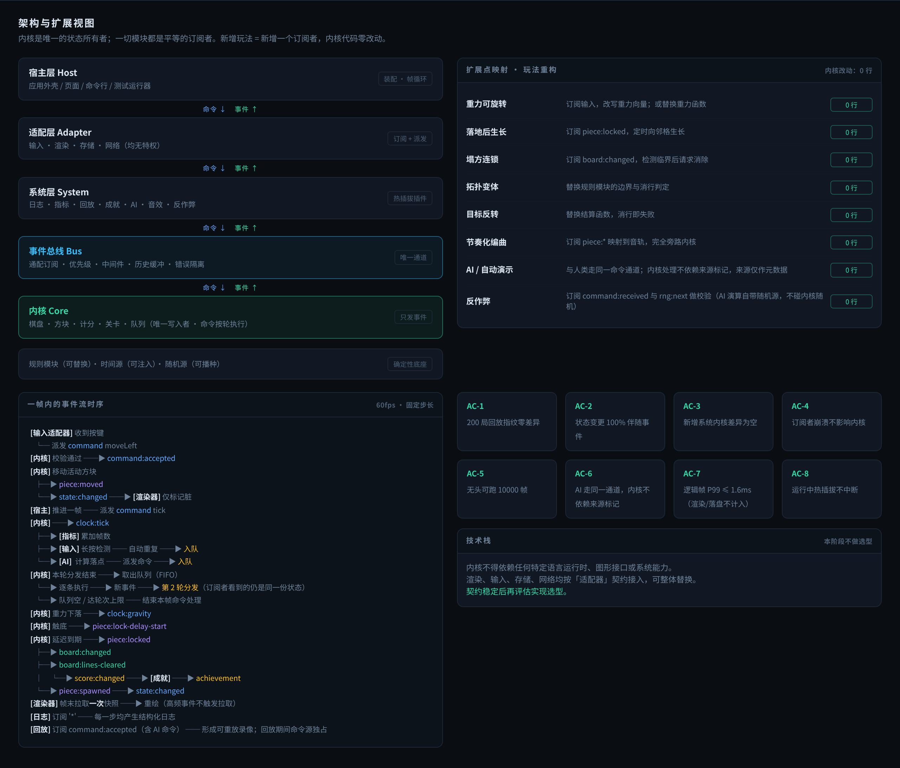

# 项目架构 · Tetris Kernel

| 项目 | 内容 |
| --- | --- |
| 本文件管什么 | 技术栈 · 目录 · 数据模型 · 模块边界 · 帧模型 · 实现红线。**只写"是什么"和"必须怎么做"** |
| 不写什么 | 为什么这么选 → `决策记录.md`；做什么不做什么 → `需求与边界.md`；分批任务 → `../PROGRESS.md` |
| 硬约束来源 | 需求文档 §3 架构约束 N1–N7、§7 NFR、§8 契约 |
| 图 | 图 2（架构与扩展视图）在 §2。源文件 `html源文件/产品预览_源文件.html` |

> **读法**：§1–§3 是骨架，§4–§5 是边界与数据结构，§6–§7 是**实现红线**（写错会静默破坏确定性或架构承诺，且大多极难定位）。动手前至少读 §6 与 §7。

---

## 1. 技术栈

### 1.1 分层选型表

| 层 | 选型 | 版本 | 说明 |
| --- | --- | --- | --- |
| 语言 | CPython | 3.12.13（conda 环境 `py312`） | 已被项目规范锁定 |
| 平台范围 | **仅 Windows x64** | — | 渲染是 tkinter、发布是 Windows exe，CI 只需一个 runner |
| 内核 / 总线 / 规则 | **纯标准库** | — | `dataclasses` + `typing` + `enum` + `json` + `random` + `time`；零第三方依赖 |
| 事件总线 | **自研**（约 300 行） | — | 见 ADR-001 |
| 渲染器 | **tkinter**（标准库） | Tk 8.6 | 主窗口承载棋盘、HOLD/NEXT、事件流面板、系统注册表 |
| 终端渲染器 | **rich** | 15.0.0 | **只服务 CLI 报告与终端渲染器**，**不进 tkinter GUI 渲染路径**（ADR-012） |
| 日志 | 标准库 `logging` + 自定义 JSON formatter | — | 多输出目标由 handler 天然支持；级别映射放在日志系统内 |
| 命令行 | 标准库 `argparse` | — | 子命令：`play` / `sim` / `replay` / `inspect` |
| 测试 | **pytest** + pytest-cov | 9.1.1 / 7.1.0 | 黄金对局用例库、事件完备性断言、参数化踢墙表校验 |
| 属性测试 | **hypothesis** | 6.170.5 | **仅 dev 依赖**，必须开 `derandomize=True` |
| 架构静态检查 | **import-linter** | 2.15 | `layers` / `forbidden` / `independence` 三类契约 |
| 内核冻结检查 | 自研（内容哈希基线） | — | 守住"内核文件差异为空"，见 §7.6 |
| 补充静态检查 | 自研脚本（AST + 文本扫描） | — | 见 §8 |
| 类型检查 | **pyright** | 1.1.414 | 内核与总线走 `strict`，其余 `standard`。建议装 `pyright[nodejs]` extra |
| Lint / 格式化 | **ruff** | 0.17.1 | **必须用环境内那一份**（ADR-052） |
| 包构建 | **uv + uv_build** | uv 0.11.24 / uv-build 0.13.5 | 只留 uv_build 一个后端 |
| 免安装 exe | **PyInstaller** | 6.22.3 | 打包方案已定，**发布时点推后到 M4 之后** |

### 1.2 环境铁律与命令

```
conda activate py312                      # 之后才能用 uv pip
uv pip install --python D:\miniconda3\envs\py312\python.exe -e .
uv pip install --python D:\miniconda3\envs\py312\python.exe --group dev
```

- 激活环境：`conda activate py312`；⚠️ `base` 是 3.13.9，**禁止用 `base` 跑本项目**
- 启动游戏：`tetris`（子命令 `play` / `sim` / `replay` / `inspect`）
- 跑测试：`pytest` ｜ 静态检查：`ruff check .` · `pyright src/tetris_kernel` · `lint-imports` · `tools/` 下自研脚本
- 格式化：`ruff format` ｜ 构建：`uv build`

**禁止**：`pip install` / `uv pip install` 到 `base`；未激活 `py312` 执行任何安装命令；**`uv sync` / `uv venv`**（会自建 `.venv` 把包装到 conda 环境之外，绕过"必须用 py312"）。

### 1.3 工具链纪律

1. **ruff 只认环境内那一份**（本机 PATH 上是 0.15.17，`py312` 内是 0.17.1）。CI 里钉死版本，否则格式化结果在不同机器上打架。
2. **hypothesis 必须开 `derandomize=True`**。只固定内核种子不够——hypothesis 自己的生成随机性也是变量，不关掉它 CI 上的偶发失败无法复现。
3. **CI 与本地必须同版本、同解释器。**
4. **平台范围仅 Windows x64。** macOS / Linux 用户自备 Python 环境跑。
5. **开工前先 `git init`。** 架构静态检查进 CI、冻结基线的刷新要有提交说明可写、"内核文件差异为空"本质就是"对比某个版本"——没有 git，这些全退化成靠自觉。

### 1.4 已验证的环境事实（2026-10-22 实测）

| 事实 | 结果 |
| --- | --- |
| conda `py312` | Python 3.12.13（`base` 为 3.13.9，禁用） |
| uv 可用 | 0.11.24；支持 `--group`；可指定 conda 解释器为目标 |
| Node.js | v24.16.0（pyright 需要） |
| ruff | PATH 上 0.15.17；py312 内 0.17.1（**以环境内为准**） |
| tkinter | py312 与 base 均可用，Tk 8.6 |
| 随机源状态 | `getstate()` 往返可完全复现；元组长 3、格式版本号 `3`、内部状态 **625 个整数**、JSON **7340 字节 ≈ 7.17 KiB** |
| PyPI 直连 / 清华 / 阿里 | 全部 200（2026-10-22 实测；发布渠道已于 2026-10-23 改为只发 GitHub，此行仅留档，见 ADR-008） |
| 项目当前状态 | 已是 git 仓库（2026-10-22 建，master 分支） |

**tkinter 定时器实测**：Windows 定时器分辨率约 15.6ms，`after(2..15)` 一律被上舍入到 ~15.6ms；`after(1)` 吃满一个核的 91%；`after(16)` 最大抖到 31.53ms 会整帧错过。**推荐 `after(5) + time.monotonic()` 累加器补帧**（~64 次/秒、0.65% 单核），设最大追帧数（默认 5）。

## 2. 总体架构

### 2.1 分层与依赖方向

```
┌──────────────────────────────────────────────────────────┐
│  宿主层 Host（应用外壳 / 页面 / 命令行 / 测试运行器）        │
├──────────────────────────────────────────────────────────┤
│  适配层 Adapter：输入 · 渲染 · 存储 · 网络（都是"系统"）     │
├──────────────────────────────────────────────────────────┤
│  系统层 System（可插拔）：日志 · 指标 · 回放 · 成就 · AI …   │
├──────────────────────────────────────────────────────────┤
│  总线 Bus（事件唯一通道，含中间件与历史缓冲）                │
├──────────────────────────────────────────────────────────┤
│  内核 Core（唯一状态所有者：棋盘/方块/计分/关卡/队列）       │
│  规则模块（可替换）· 时间源（可注入）· 随机源（可播种）      │
└──────────────────────────────────────────────────────────┘
```

依赖方向恒为 `host > adapters > systems > bus > kernel > rules > contracts`（由 `lint-imports` 持续校验）。内核对上层零引用；系统之间不允许直调，只能通过事件间接协作。

### 2.2 四条主干结论

1. **层间只有两条通道**：命令向下、事件向上。不存在横向或跨层直连。
2. **所有玩法重构的内核改动量必须为 0 行**（`需求与边界.md` §10 逐条列出）。做不到说明边界划错位置，应回退修正而非打补丁。
3. **一帧内的执行顺序是确定的**（详见 §6.6）。
4. **事件分发期间内核状态不变**：同一次分发中的所有订阅者看到同一份状态快照；分发期间派发的命令进入命令队列，于下一轮执行。递归被展开为同帧内的多个轮次，而非调用栈上的层层嵌套。



**图 2　架构分层、扩展点映射与帧内时序的合并示意（数值为示例值）**

### 2.3 import-linter 契约骨架

```
host  >  adapters  >  systems  >  bus  >  kernel  >  rules  >  contracts
systems 各子包之间再加 independence 契约（系统之间只允许通过事件协作）
kernel / bus / rules 再加 forbidden 契约：不得 import rich、tkinter 及任何第三方包
contracts 是公共叶子：不得 import 任何东西，允许被所有层 import（含 kernel）
variants 与 systems 同级：可 import systems / rules / contracts，
    但禁止 import kernel / bus / adapters / host
```

## 3. 目录结构

```
Tetris/
├─ pyproject.toml          包元数据 + ruff / pyright / import-linter 配置
├─ AGENTS.md               给 AI 的规范（短）
├─ PROGRESS.md             当前在攻 / 待办 / 卡点
├─ ai_docs/                AI 决策日志，一周一个文件
├─ docs/
│  ├─ 需求与边界.md         做什么 / 坚决不做什么
│  ├─ 项目架构.md           本文件
│  ├─ 决策记录.md           轻量 ADR
│  ├─ image/              三张图
│  └─ html源文件/          两份 HTML 源文件：图 1 + 图 2 合一份，图 3 单独一份（改图改这里再重新截图）
├─ src/tetris_kernel/
│  ├─ kernel/    内核：状态所有者、命令校验、事件信封、快照、可播种随机源
│  ├─ bus/       事件总线：订阅模式、优先级、中间件、环形历史、异常隔离、只读视图
│  ├─ rules/     规则模块：消行判定 / 重力 / 计分 / 边界 + 形状表与踢墙表
│  ├─ contracts/ 事件类型注册表与契约定义（**冻结区外**；不 import 任何东西）
│  ├─ systems/   可插拔系统：日志 / 指标 / 回放 / 成就 / AI（互相不许直调）
│  ├─ variants/  变体实现目录（独立目录，不碰冻结区）
│  ├─ adapters/  输入与渲染适配器（tkinter）
│  └─ host/      装配层、帧循环、CLI
├─ tests/        黄金对局用例库、事件完备性检查、架构契约测试、属性测试
│  └─ baseline/  内核冻结哈希基线
└─ tools/        静态检查补充脚本
```

## 4. 模块边界

### 4.1 各包职责

| 包 | 职责 | 硬边界 |
| --- | --- | --- |
| `host/` | 装配层、帧循环、CLI | 唯一知道"怎么把部件拼起来"的地方 |
| `adapters/` | 输入（DAS/ARR）与渲染（tkinter） | 不得写内核状态；渲染器不得用只读视图通道 |
| `systems/` | 日志 / 指标 / 回放 / 成就 / AI | 只能订阅事件 + 派发命令；**互相不许直调** |
| `bus/` | 订阅、优先级、中间件、环形历史、异常隔离、只读视图、全局序号 | 序号的唯一权威；不得被内核 import |
| `kernel/` | 唯一状态所有者；命令校验；快照；随机源 | 不 import 总线；零第三方依赖；禁读墙钟 |
| `rules/` | 四项可插拔规则 + 形状表与踢墙表 | 接口只用中性类型，不 import kernel 的任何 dataclass |
| `contracts/` | 事件类型注册表与机器可读契约声明 | 不 import 任何东西；只增不改 |
| `variants/` | 变体实现 | 禁止 import `kernel` / `bus` / `adapters` / `host` |

### 4.2 内核与总线的边界

内核**不 import 总线**。内核对外只有两个接口：

- `execute(cmd) -> tuple[EventDraft, ...]`（原子命令）
- `advance_frame() -> Iterator[tuple[EventDraft, ...]]`（帧推进的步骤序列）

**全局序号的唯一权威在总线**（草稿不含序号，总线在入队时封装信封并分配）。装配层负责"执行 → 取回草稿 → 发布 → 队列非空则下一轮"。这样"分发期间内核状态不变"才是结构性事实，而不是约定。

### 4.3 两个订阅入口与只读视图

- `subscribe(event)` **单参数**：给适配器与渲染器，`bus.publish` 可用，**无视图**。
- `subscribe_system(event, ctx)` **双参数**：给系统层，`ctx.view()` 惰性取视图。

两个入口**共享同一个订阅者注册表与优先级序列，排序在合并之后进行**——否则"业务订阅者先于日志订阅者"（FR-3.3，M 级）在跨入口时不成立。

**不提供 `bus.view()` 这类访问器**：它可以在任何时候被调用，那时内核处于什么状态没有定义，会把"分发期间内核状态不变"退回成约定。上下文形式天然关掉这个口子。

### 4.4 冻结区与基线

- **冻结区 = `kernel/` + `rules/`**，做内容哈希基线（`tests/baseline/kernel_hashes.json`），哈希前归一化换行符，按批次刷新，更新只能走显式 `--update-baseline`。
- **`bus/` 暂不冻结**（M2 要给总线加中间件、历史查询、计数，批批刷新基线会变成橡皮图章），另列独立基线，等 M2 总线封板后再启用。
- **`contracts/` 有"只增不改"基线**：键 = 事件类型名，值 = 该类型**负载字段声明**的哈希（不哈希 `.py` 文件内容，否则改个注释就报警）。允许新增键，禁止已有键的哈希变化。命令参数规格、快照字段声明与**规则接口签名声明**同样进基线（§4.4 第四部分，ADR-061）。

### 4.5 变体边界

变体是"用既有内核能力拼出新玩法"的东西。变体要的一切都必须走 **`rules` 替换** 或 **`systems` 插件** 两个口子；变体的自定义状态由变体自己持有，帧末由宿主合并进 `extensions`，**不让内核认识变体**。

## 5. 数据模型

### 5.1 事件信封与负载

信封：`序号 / 帧号 / 类型 / 负载 / 元数据`（**五字段**）。序号全局单调递增，构成事件溯源的时间轴。**不设"逻辑时间戳"字段**（ADR-062）——逻辑时间 = 帧号 × 步长，派生即可；步长由 `clock:tick` 的负载给出、录像头记录。

- **元数据三键**（v1 定死，需求 §8）：`source`（命令来源，内核**不得因它分支**）· `producer`（产出者，总线在分发时自动填，与需求 §8.1 的"产出者"列一致）· `cause`（引发本事件的那条命令的 **(帧号, 帧内序号)**，`None` = 无上游命令）。**`cause` 不指向全局事件序号**——序号由总线入队时分配（§4.2），内核生成草稿时还拿不到它。未知键静默保留但不解释（NFR-9）。
- **负载一律不可变**：`frozen=True` dataclass；清单类字段用 `tuple[tuple[int, int, int], ...]`；构造完成即不可变。事件会被送到后台线程消费，可变负载会造成撕裂读，且只在日志侧表现为偶发错乱。
- **自产事件复用轮次机制**：`log:entry` / `metric:sampled` / `achievement:unlocked` 与"订阅者派发的命令"是同一种东西——分发期间产生、必须延后处理。总线维护待发布队列，当前分发结束后按 FIFO 发出，序号入队时分配。不新造概念。
- **未知事件容错**：遇到未注册事件类型，按信封解析后静默丢弃或记 trace，不得中断分发或重放。

### 5.2 快照、视图与存档

| 概念 | 是什么 | 关键约定 |
| --- | --- | --- |
| 快照 | 内存只读视图（导出时深拷贝，不与内核共享内层结构） | **绝不 JSON 化**；棋盘字段标 `tuple[tuple[int, ...], ...]` |
| 只读视图 | 分发期间给系统层看的状态 | **与快照是同一个 dataclass**，不写两套 |
| 存档 | 序列化后的自包含数据 | 只有存档才序列化随机源状态；录像头额外记 `rngStateVersion` 与 `pythonVersion` |

- **内核内部用可变结构**（`list[list[int]]`），快照导出时**深拷贝**成不可变视图——只冻结外层会让快照与内核共享内层列表，渲染器一改就破"只有内核能写状态"。
- **快照字段名、类型与坐标系在需求 §8.3 定死**：`board` 子结构 = `width` / `height` / `hiddenRows` / `cells` / `structureFingerprint`；坐标 x 右正、y 下正，**第 0 行是顶部**，`cells` 行优先（与 §5.4 的 TLV 口径同一条）；`hiddenRows` 是"数量"而不是"可见起始行"（后者有 0/1 起始歧义，错了整片错位）。
- **视图构造必须纯读**：不得触碰随机源（尤其不能惰性初始化 RNG），不得改任何内核状态——否则"关闭全部可观测系统后内核行为逐帧一致"这条判据在概率上就废了。
- **视图缓存粒度是"一次发布"（发布点），不是步骤名**。一条命令产生两次发布（`received` 执行前、`accepted` 执行后），AI 一帧多条命令时更多；用步骤名当键，订阅者会读到**过期**状态（不崩、结果偏、极难发现）。`ctx.step` 只是标签，取值集合含 `frame_end`。术语上"步骤"（帧推进五步）与"发布点"（一次 publish）分开。
- **`rngState` 是两条构造路径**：`snapshot()` 构造时为 `None`，存档路径用 `dataclasses.replace(snapshot, rngState=...)` 填。字段类型 `tuple[int, ...] | None`，pyright strict 强制消费方处理 `None`。**不要在 `frozen=True` 上惰性赋值**。
- **`rngState` 不进常规视图**（它是存档用）。

### 5.3 随机源与时间源

- 标准库 `random.Random`（Mersenne Twister），已实测 `getstate()` / `setstate()` 往返可完全复现。
- **只用两个原语 `random()` 与 `getrandbits()`**，7-bag 洗牌自己实现 Fisher-Yates（ADR-010）。
- **内核随机源只服务内核**，AI 搜索必须自建实例并显式 `np.random.default_rng(seed)`。
- 真实时钟 `time.monotonic()`，虚拟时钟外部显式推进；**宿主的帧循环时钟也必须可注入**，否则回放、逐帧步进、倍速播放做不了。
- 内核禁读墙钟：`kernel/` 与 `rules/` 内不得出现 `time.time()`、`time.monotonic()`、`datetime.now()`、模块级 `random.*`、未注入的 `random.Random()`、`os.urandom`、`uuid.uuid4`。`id()` 只警告不阻断。

### 5.4 扩展槽与指纹

- **扩展槽定形**：`extensions: tuple[tuple[str, JsonScalar], ...]`，**只放标量**（`int`/`float`/`str`/`bool`/`None`），**禁止容器与嵌套**——复杂状态由变体自己持有。M3 随内核一次性定型，内核只原样携带与序列化、**不理解内容**。
- **key 必须唯一**（它是 tuple 不是 dict，可写重复 key）：宿主合并时校验，重复即结构错误并记错，不"去重取末值"。
- **`extensionFingerprint`** = `extensions` 的规范化摘要，与 `extensions` 同处构造。变体局的回放校验把它作为**第五项**（棋盘指纹/分数/行数/方块数之外）——结构指纹不含扩展字段，变体状态分叉时四项比对会全绿。
- **指纹用稳定哈希 + TLV 编码**：`hashlib.blake2b` 对**规范化字节序列**求摘要。TLV = 1 字节类型标签 + 4 字节小端长度 + 值，标签覆盖 None / bool / int / float / str / tuple（元组先写元素个数再写各元素 TLV，解决元素边界）。棋盘按行优先、`extensions` 按 key 排序；**输入前加域分隔前缀**；布尔与整数必须区分编码；**指纹基于内存值，不基于 JSON 文本**。
- **不用 Python 内置 `hash()`**：`str`/`bytes` 的 hash 受 `PYTHONHASHSEED` 随机化影响，跨进程不稳定。

### 5.5 录像与存档

- **一个录像 = 一局**：`game:created` 时开新录像（头写种子 + 规则集标识 + 版本）；`reset` 被接受时结束当前录像并开下一份。这样录像里帧号永不重复，回放不需要分段逻辑。
- **录像不记 tick**（ADR-024）：回放宿主自己每帧生成一条 tick，靠 `pause`/`resume` 的帧号 + 内核门禁重建空档。
- **版本兼容判据只有一个**：这个变更会不会改变重放结果。会（规则语义变、随机源状态格式变、Python 跨 MT 状态格式）→ **拒绝并明确提示**；不会（纯新增元数据字段）→ 缺失用默认值兼容。major 变 = 拒绝，minor 变 = 兼容。
- 序列化用标准库 `json`（ADR-017）。

## 6. 帧模型与时序

### 6.1 帧号语义（最容易错的一块）

- **帧号推进与推进许可是两件事**：帧号 +1、帧内序号归零在 tick **出队时**发生（在 `command:received` 发布之前）；推进许可（`clock:tick` + `advance_frame()`）在 tick **被接受**时授予。
- **一帧 = 一条 tick，tick 是本帧的推进开关**。倍速 = 连续跑 N 帧（不是一帧塞多条 tick）。
- **帧首以 tick 为队首重建队列**：tick 插到队首，上帧遗留命令排其后；tick 恒定是本帧第 1 条命令。
- **帧号在暂停期照走是有意为之**：帧号 = 宿主逻辑帧；**有效游戏帧数 = `clock:tick` 计数**，不要用帧号差算存活时长。
- **`reset` 归零帧号、帧内序号与版本号**（FR-1.4"与首次启动完全等价"包含帧号）。
- **帧号局内唯一，但事件序号是唯一时间轴**：`reset` 后环形历史里会有两局的"帧号 100"。区间查询与时间旅行一律按**全局事件序号**查，局间以 `game:created` / `game:reset` 的序号分界。

### 6.2 帧推进五步

`advance_frame()` 产出步骤序列：**重力 → 锁定 → 消行 → 塌落 → 出生**。

- **必须 step 化**，不能一次 execute 返回整批草稿。整批会让所有事件共享"执行后的最终态"，`piece:locked` 的订阅者读到的是已消行、已塌落、已出生的棋盘。
- **加一步的充要条件**：某个订阅者需要在两个既有步骤之间观察一个稳定状态，**且**该状态无法由任一既有事件的负载自足表达。两问都答不上来就不加步。
- **必须完整消费**：装配层**不得提前 break**（用 `try/finally` 保证耗尽）——半帧状态后续全错，而且静默。每个步骤内部**先算完再一次性写入**。订阅者异常被隔离，不得中断后续步骤。
- **推进前要复查 phase**：`clock:tick` 分发期间若有人派发 `pause`，它会在下一轮被执行。所以首个步骤前必须复查 phase，不是 running 就直接结束本帧。

### 6.3 命令追溯标识

- 标识是 **(帧号, 帧内序号)**，不分配全局 id。帧内序号只对**被接受**的命令编号（每帧归零，被拒的不占号）。
- **tick 也占号**（正常帧里占 0），否则 tick 与帧内第一条玩家命令会共用同一个句柄。注意与"tick 不计入命令数配额"区分：那是配额计数器，这是序号计数器。
- **回放宿主自生成的 tick 同样占帧内序号 0**，否则句柄整体错位一格。
- **`command:received` 在出队执行前发，不在入队时**：入队时本帧帧号尚未确定，在入队时发会让帧号差一帧，回放对齐整体错位。配额丢弃时**先补 `received` 再补 `rejected`**。

### 6.4 轮次与配额

- **两个计数器按帧累计**（每帧开始清零，不是按单轮）。`tick` 自身不计入命令数。
- 超限判定发生在"取队执行"之前，超限丢弃剩余命令并补发 `command:rejected`（reason=`quota_exceeded`），**逐条计入合并计数**，不跨帧顺延。帧推进的步骤不占配额。
- **两类配额超限统一用 `kernel:quota-exceeded`**（靠负载里的配额名区分）。`kernel:error` 只留给订阅者异常这一种语义。

### 6.5 同因拒绝合并防抖

同一 phase 下连续被拒的命令**只发第一条**，后续合并计数；phase 变化或 `resume` 后重置计数并重新发首条。

- 合并的键 = **(phase, 命令类型, 拒绝原因)**。
- `received` 与 `rejected` **成对合并、计数一致**。
- **`mergedCount` 起始值 = 1**（"这条事件代表 1 次拒绝"）。
- **满足形式是"一条事件承载 N 次拒绝"，不是"没有事件"**——否则事件完备性检查会误判成事件缺失。
- **配额超限是本条最典型的应用场景**（配额满时队列里剩 50 条命令，走合并分组，不是刷 50 条事件）。

### 6.6 一帧内的时序

```
[输入适配器] 收到按键 └─> 派发命令 moveLeft
[内核] 校验通过 ──> command:accepted ──> 移动 ──> piece:moved ──> state:changed
[宿主] 推进一帧 └─> 派发命令 tick
[内核] ──> clock:tick
   ├─> [指标系统] 累加帧数
   ├─> [输入系统] 检测长按 ──> 派发命令 ──> 入队
   └─> [AI 系统] 计算落点 ──> 派发命令 ──> 入队
[内核] 本轮分发结束 ──> 取队列（FIFO）逐条执行 ──> 新一轮分发（Round 2）
[内核] 重力 ──> clock:gravity ──> 触底 ──> piece:lock-delay-start
   └─> 延迟到期 ──> piece:locked ──> board:changed ──> board:lines-cleared
       ──> score:changed ──> [成就] ──> achievement:unlocked ──> piece:spawned
[渲染器] 帧末拉取一次快照 ──> 重绘（高频事件不触发拉取）
[日志/回放] 全程旁路订阅，不参与主线
```

- **帧末的定义**：命令轮次循环结束（队列清空或超限）**且**帧推进的步骤序列跑完。快照不能拉在中间某轮之后。
- **`state:changed` 每帧至多一条，帧末产出**：版本号每次变更递增是**内部计数器**的行为，不等于每次变更都发一条事件。它只是脏标记的载体，脏标记实际由 `version` 承担。
- **`render:frame` 是渲染完成后发的结果事件**，只供性能监控订阅，不是拉快照的触发时机（用它触发就是循环引用）。

### 6.7 两层暂停

| | 宿主级暂停（回放/播放） | 内核级暂停（游戏内 `pause`） |
| --- | --- | --- |
| 帧循环 | 不跑 | 照常跑并入队 tick |
| 帧号 | **冻结** | 照走 |
| 命令 | **不产生任何命令** | 由内核门禁裁决 |

- **回放暂停若实现成内核级 `pause`**：`pause`/`resume` 是被接受的命令 → 会录进录像 → **回放自己污染录像**。
- **`resume` 生效的那一帧不推进，这是设计不是缺陷**：推进许可在本帧第 1 条命令（tick）就裁决完了。本帧内发生的任何 phase 变化都只能影响下一帧。M1 调手感时会有人来"修"，正确做法是什么都不做。
- **逐帧步进属宿主级，且仅对 running 态有意义**（paused 态按单步 = 什么都不发生，UI 应禁用或先 resume）。

## 7. 实现红线

> 每条都来自需求终版或已定设计。写错会静默破坏确定性或架构承诺，且大多极难定位。

### 7.1 内核与总线

- **内核不 import 总线**（§4.2）。总线做"内核 ↔ 总线"的反向调用会让内核依赖总线，并把分发时机埋进内核。
- **统一 phase 门禁**：命令校验层前置一个 guard，phase 非 running 时除 `start`/`pause`/`resume`/`reset` 外一律拒绝。不散落在各命令里各判各的。
- **回放期间命令源独占**：replay 模式**优先卸载** AI / 教学 / 网络系统。兜底由**宿主层**拦截派发——内核不按运行模式分支（FR-8.5），而 `source` 在回放时透传录像原值、也不能当模式判据（ADR-062）。
- **内核内部棋盘用可变结构**，不用 tuple（每次落子都要整体重建嵌套元组）。

### 7.2 命令与事件

- **命令事件必须带命令参数**：`received` / `accepted` / `rejected` 的负载都要带不可变 `args`。缺了参数，标准玩法能重放，但 M4-B 生长变体靠 `writeCells` 带参数，会"能重放但结果不对"——不报错，最难查。
- **`args` 禁浮点而 `extensions` 允许浮点，口径不同是对的**：`args` 参与**重放**（参数不能漂），`extensions` 不参与重放判定。不写明理由就会被当成不一致顺手统一。
- **命令参数必须能无损往返 JSON**：只含 JSON 标量与其元组，反序列化按命令类型还原。
- **`rng:next` 默认开启**（不随调试事件一起关）：随机序列审计依赖它，频率不高（7-bag 每方块约 1 次取值），代价可忽略。要关走降级第 ① 档。
- **`rng:next` 的负载要瘦身**：「随机值 + 序号 + 状态指纹（短哈希）」，**不含完整 MT 状态**（625 整数 ≈ 7.17 KiB，一局几百方块就是几 MB 常驻负载）。

### 7.3 规则模块

- **接口只用中性类型**：`Sequence[Sequence[int]]` / `int` / `str` / `tuple`，不 import kernel 的任何 dataclass。否则 `kernel > rules` 契约第一天就红，然后大概率被加豁免，契约就废了。
- **签名必须一次性覆盖变体维度**（**M0 定稿**，`M3-18` 降级为复核，ADR-061）：重力**方向**、消行**轴向**、计分**模型可整体替换**、边界**拓扑**；**规则集还要能提供形状表与踢墙表**。M4 只能填实现、不得改签名。
- **拓扑维度是坐标映射函数，不是参数**：规则集提供 `wrap_cell(x, y, w, h) -> tuple[int, int]`（标准=恒等、圆柱=x 环绕、莫比乌斯=x 环绕 + y 翻转），**内核在所有坐标访问点都过一遍**，标准玩法走恒等快路径。
- **形状表与踢墙表由规则集整体提供，内核不做变换**：不要实现成"内核拿标准表 + 方向参数去旋转偏移"。
- **规则表落成 Python 字面量常量**，不要落成外部数据文件（ADR-032）。

#### 7.3.1 四项接口与两张表（M0 定稿，ADR-061）

签名用中性类型；运行时量由内核通过 `RuleContext` 传入，**规则集无状态、不可变**。

`RuleContext`（定义在 `contracts/`，公共叶子）：`frame: int` · `level: int` · `piecesPlaced: int` · `axis: str`（重力轴，`down` / `left` / `right` / `up`）· `stepMs: int`。

| 能力 | 签名 | 要点 |
| --- | --- | --- |
| 边界（拓扑） | `wrap_cell(x: int, y: int, w: int, h: int) -> tuple[int, int]` | 坐标映射函数，不是参数（ADR-037） |
| 重力 | `gravity_vector(ctx: RuleContext) -> tuple[int, int]` | **方向必须是向量 (x, y)**，不能只有 dy——横向重力时 dy = 0 |
| 重力 | `gravity_interval(ctx: RuleContext) -> int` | 多少逻辑帧落一格 |
| 消行 | `scan_clears(board: Sequence[Sequence[int]], ctx: RuleContext) -> tuple[ClearGroup, ...]` | 返回"轴 + 行/列索引 + 格子清单"，**不能只返回数量** |
| 消行 | `classify_placement(board: Sequence[Sequence[int]], placement: PlacementInfo, ctx: RuleContext) -> PlacementClass` | T-Spin 三分 + Mini（FR-4.7），**归消行判定模块，不另开第五项**（FR-4.9 仍是四项） |
| 计分 | `score_clear(groups: Sequence[ClearGroup], ctx: RuleContext, prev: ScoreState) -> ScoreDelta` | 纯函数：返回增量与新状态，**落笔由内核做** |
| 形状 | `shape_cells(ctx: RuleContext, pieceType: str, rotation: int) -> tuple[tuple[int, int], ...]` | **必须带 `ctx.axis`**（见下） |
| 踢墙 | `kick_offsets(ctx: RuleContext, pieceType: str, fromRotation: int, toRotation: int) -> tuple[tuple[int, int], ...]` | 同上，且含 180° |

三条纪律：

1. **规则集不可变，随时间的一切都是关于 `ctx` 的纯函数**——规则集一旦持有可变状态，FR-10.2 的存档恢复就得额外序列化规则集状态；纯函数则天然可恢复，也与 ADR-032「规则表落成字面量常量」同构。
2. **形状表与踢墙表必须带轴维度**：M4-A5（形状表 / 踢墙表随重力方向变换）与「内核不做变换、表由规则集整体提供」两条合起来，接口不带轴就选不出表。**这是签名必须现在定的核心理由**，不是锦上添花。
3. **T-Spin 判定需要放置上下文**（最后动作、踢墙偏移、是否最后移动），由内核提供 `PlacementInfo`。

**运行期切换的载体（原本是需求的一处空白）**：需求 §10 说变体 A「切换经命令通道」，但命令目录里没有对应命令。解法不是新增一条"换轴"命令，而是**排到 M3**：M0 只把 `axis` 作为 `RuleContext` 的字段预留（签名必须覆盖变体维度），M3 增补"运行期换规则集"的命令与门禁——内核改动随 M3 刷新基线（§4.4），G4-1 约束的是 M4 落地变体时不受影响，于是 **M4 变体 A 直接用 M3 已有的能力，内核文件差异为空**。

**冷却 / 防抖动不在内核**：它是输入适配器的节流（ADR-044「手感参数归输入适配器」的精神）或插件自己的策略——内核与规则集都不需要知道"多久能再切一次"，所以 M0 的签名集不必为它留维度。**这条若搞混，就会有人给内核加一个 `lastSwitchFrame` 字段，再把规则集签名撑出一个"能否切换"的维度——那正是本节要避免的"补维度"。**

### 7.4 观测与降级

- **降级顺序固定**：关闭调试事件 → 降低日志级别 → 关闭事件历史缓冲。三档都不伤指标系统。**不得引入"关闭事件分发"的快速模式**。任何退化模式都要用少量局指纹与完整模式对比验证。
- **手动降级只开放第 ① 档**；第 ② 档归日志系统自己的配置项管，第 ③ 档不暴露（用户手关会让时间旅行调试"看起来坏了"）。
- **自动降级必须带滞回**：600 帧滑动窗口 P99 > 1.6ms 降一档，P99 < 1.0ms 且持续 1800 帧才升一档。判据用 P99 不用均值。
- **日志落盘异步，录制走同步**：日志/指标走后台线程 + 有界队列 + 丢弃计数 + 周期性 warn；**回放录制走同步订阅者**（内存 list 累积，局末或周期点一次性落盘）——"不可丢"靠**没有队列**保证。
- **`render:frame` / `state:changed` 的用法**见 §6.6。

### 7.5 性能与进程

- **千局模拟用多进程**：`ProcessPoolExecutor`，**每局一个任务，进程池大小 = CPU 核数**（不是每局 fork 一个进程）。`chunksize` 建议 >1。**汇总前按种子排序**，否则浮点累加顺序随调度变化，统计输出不可复现。
- **AI 耗时红线用单局墙钟**：无 AI 单局 ≤2s / 千局 ≤10min；带 AI 单局 ≤10s / 千局 ≤25min（8 核）；千局门判据 ≤30min。
- **AI 的搜索预算必须固定**：固定深度/迭代次数，**禁止按耗时自适应、禁止帧内增量搜索**（ADR-028）。AI 每帧重算没问题：重算次数由策略决定，不由耗时决定。
- **numpy 只进 AI 系统**：AI 的浮点结果只影响选哪个落点，而落点以命令形式录进录像，所以回放不受影响；但"同种子同权重复现 AI 决策"需固定 numpy 版本 + 显式 `np.random.default_rng(seed)`。
- **Windows 上 `ProcessPoolExecutor` 用 spawn**：worker 函数必须模块级可导入、参数必须可 pickle。

### 7.6 冻结与基线

- **内核文件不得被改动**：对 `kernel/` + `rules/` 做内容哈希基线。冻结区严格对齐 G4-1，`bus/` 暂不冻结（§4.4）。
- **事件类型注册表在冻结区外**：放 `contracts/`，**绝不进 `kernel/` 或 `rules/`**。变体加事件类型时若常量表在冻结区，冻结检查必红——要么加豁免（冻结作废），要么改内核（G4-1 作废）。
- **`contracts/` 要有"只增不改"基线**，哈希的是**机器可读声明**（四部分：事件类型 → 负载字段；命令类型 → 参数规格；快照字段 → 类型；规则接口签名）。文档与声明靠"生成"或"校验"保持一致。**基线首次生成于契约文档 v1（M0-28）落定的时刻**，v1 之前都是"定稿前的编辑"。签名进基线是"规则接口在 M0 定死"这件事的牙齿——改签名会撞基线，只能走显式 `--update-baseline` 并写明理由。
- **指纹用稳定哈希 + TLV**（§5.4）。

### 7.7 变体

- **`variants/` 与 `systems` 同级**，禁止 import `kernel` / `bus` / `adapters` / `host`。
- **扩展槽定形**、**key 唯一**、**`extensionFingerprint`**（§5.4）。
- **变体局的回放校验要多比一项**扩展指纹，与结构指纹并列进 G4-2。

## 8. 静态检查与质量命令

| 检查 | 命令 | 守什么 |
| --- | --- | --- |
| 依赖方向 | `lint-imports` | §2.3 三层契约 |
| 类型 | `pyright src/tetris_kernel` | 内核与总线 strict |
| Lint / 格式 | `ruff check .` / `ruff format` | 用环境内 0.17.1 |
| 内核纯净度 | `tools/` 自研脚本 | 禁第三方 import、禁平台名 |
| **事件类型登记** | `tools/` 自研脚本 | **扫 `contracts/`，不是 `kernel/`**；类型必须已登记 |
| 内核冻结基线 | `tools/` 自研脚本 | `kernel/` + `rules/` 哈希 |
| `contracts/` 只增不改基线 | `tools/` 自研脚本 | 见 §4.4 |
| 内核禁读墙钟 | `tools/` 自研脚本（AST） | §5.3 |
| 测试 | `pytest` | 含 hypothesis 属性测试 |

**属性测试纪律**（hypothesis）：内核随机源固定种子；断言内核不崩、无静默状态变更、同序列重跑指纹一致、拒绝不改状态。

## 9. 打包与发布

- **只发 GitHub，不发 PyPI**（2026-10-23 定，ADR-008）：交付渠道是 GitHub Releases——源码 tag + 产物附件。**否决 PyPI**：包名 `tetris` 已被他人占用（`dzshn/python-tetris`），本项目不能顶着别人的名字发布；改名后又没有必须上架的理由，而 PyPI 的版本号一旦发布就不能重用。
- **产物两类**：`uv build` 产出 sdist + wheel（给不想 clone 的人）；PyInstaller 产出分窗口版（双击即玩）与控制台版（跑 `sim` / `replay` / `inspect`）两个 exe——`--windowed` 下 `sys.stdout`/`stderr` 会被置为 `None`，而 rich 默认写 stdout。
- **打包前先做非 editable 安装**：`uv pip install .`（不是 `-e .`），editable 的 `.pth` 在 `--onefile` 打包时偶发解析失败。
- **发布时点整体推后到 M4 之后**：M4 之前没有值得发布的东西。**exe 在国内的下载点**（GitHub Release 直链是否够快、要不要额外的镜像）随发布落点一起在 M4 前定。
